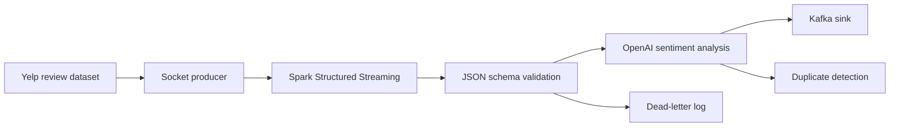

# Spark Realtime Streaming

A small streaming pipeline that reads review events from a socket, validates and enriches them, and publishes them to Kafka with a resilient Spark Structured Streaming job.

[](https://www.python.org/)
[](https://spark.apache.org/)
[](https://www.confluent.io/cloud/)
[](https://www.docker.com/)

## Overview

This project demonstrates how a streaming data pipeline can be kept simple, readable, and resilient without turning into a large enterprise platform.
## Pipeline



## What the project does

- Reads review records from a local socket source
- Parses the payload with a strict schema
- Drops duplicate review IDs using idempotent processing logic
- Sends invalid or failed records to a dead-letter file for inspection
- Calls OpenAI to classify sentiment as POSITIVE, NEGATIVE, or NEUTRAL
- Publishes the enriched output to a Kafka topic
- Runs inside Docker with a Spark master and worker

## Architecture and project structure

```text
spark-realtime-streaming/
├── README.md
├── LICENSE
├── .env.example
├── .gitignore
├── pyproject.toml
├── src/
│   ├── Dockerfile.spark
│   ├── docker-compose.yml
│   ├── requirements.txt
│   ├── config/
│   │   └── config.py
│   ├── jobs/
│   │   ├── spark-streaming.py
│   │   └── streaming-socket.py
│   ├── datasets/
│   │   └── yelp_academic_dataset_review.json
│   ├── schemas/
│   │   └── reviews.schema.avsc.py
│   ├── spark_realtime_streaming/
│   │   └── (package scaffolding)
│   └── streaming/
│       ├── idempotency.py
│       ├── kafka.py
│       └── sentiment.py
├── tests/
│   ├── test_config.py
│   └── test_streaming_dedupe.py
├── tmp/
│   └── spark-checkpoints/
│       └── kafka-stream/
└── .venv/
```


## Prerequisites

Before running the project, make sure you have:

- Docker Desktop or Docker Engine
- Python 3.14 or a compatible Python environment
- Access to a Kafka-compatible broker or Confluent Cloud cluster
- An OpenAI API key
- A terminal with Git installed
- Optional: Windows Hadoop binaries if you plan to run Spark locally outside the Docker setup

## Environment setup

1. Clone the repo:

```bash
git clone https://github.com/<your-username>/spark-realtime-streaming.git
cd spark-realtime-streaming
```

2. Create your local environment file:

```bash
cp .env.example .env
```

3. Fill in your real values in `.env`:

```bash
OPENAI_API_KEY=your-openai-api-key
KAFKA_SASL_USERNAME=your-kafka-api-key
KAFKA_SASL_PASSWORD=your-kafka-secret
KAFKA_BOOTSTRAP_SERVERS=your-bootstrap-server:9092
KAFKA_SECURITY_PROTOCOL=SASL_SSL
KAFKA_SASL_MECHANISM=PLAIN
KAFKA_SESSION_TIMEOUT_MS=50000
KAFKA_ACKS=all
KAFKA_ENABLE_IDEMPOTENCE=true
KAFKA_RETRIES=5
KAFKA_MAX_IN_FLIGHT_REQUESTS=5
KAFKA_DELIVERY_TIMEOUT_MS=120000
KAFKA_REQUEST_TIMEOUT_MS=30000
KAFKA_TOPIC=customers_review
SOCKET_HOST=spark-master
SOCKET_PORT=8522
```

## Install dependencies

Using a virtual environment:

```bash
python -m venv .venv
# macOS / Linux
source .venv/bin/activate
# Windows PowerShell
# .\.venv\Scripts\Activate.ps1

python -m pip install --upgrade pip
python -m pip install -r src/requirements.txt
```

## Run the project with Docker

Start the Spark cluster:

```bash
docker compose -f src/docker-compose.yml up --build -d
```

This starts the Spark master and worker containers and configures the environment variables from the local `.env` file.

You can confirm the Spark UI is available here:

- http://localhost:9090

## Quick start

### 1) Start the socket producer

Open a second terminal and run:

```bash
python src/jobs/streaming-socket.py
```

This script emits review records over a TCP socket and feeds the Spark streaming job.

### 2) Submit the streaming job

In another terminal, run:

```bash
docker exec -it spark-master /opt/spark/bin/spark-submit \
  --master spark://spark-master:7077 \
  --packages org.apache.spark:spark-sql-kafka-0-10_2.13:4.3.0 \
  /opt/spark/jobs/spark-streaming.py
```

The Spark job will:

- read the socket stream
- validate the incoming JSON payload
- deduplicate records by `review_id`
- classify sentiment with OpenAI
- write enriched records to Kafka
- log invalid or failed records to a dead-letter file

## Windows notes

If you run Spark locally on Windows, make sure Hadoop binaries are available for checkpointing and local execution:

- `HADOOP_HOME` should point to your Hadoop installation
- `winutils.exe` and `hadoop.dll` should be present in the `bin` directory

Example:

```powershell
setx HADOOP_HOME C:\hadoop
```

## Testing

The project includes a small validation layer for configuration and idempotency behavior:

```bash
pytest
```

This checks the environment-driven config flow and the duplicate/dead-letter handling logic.

## Contributing

Contributions are welcome. If you want to improve the project:

1. Fork the repository
2. Create a feature branch
3. Add or update tests for the behavior you change
4. Submit a pull request with a clear summary

## License

This project is licensed under the MIT License. See [LICENSE](LICENSE) for details.

## Contact

If you want to discuss the project, suggest improvements, or collaborate on the next iteration, open an issue in the repository.
