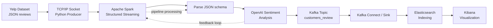

# Real-Time Streaming with Apache Spark, TCP Socket, OpenAI, and Kafka

A practical end-to-end streaming project that reads records from a JSON dataset, pushes them over a TCP socket, processes them in real time with Apache Spark Structured Streaming, enriches each review with an OpenAI sentiment label, and publishes the result to a Kafka topic.

This repository is designed as a hands-on learning project for building data engineering pipelines with Python, Spark, Kafka, and LLM-based inference.

## Table of Contents

- [Introduction](#introduction)
- [System Architecture](#system-architecture)
- [What You Will Learn](#what-you-will-learn)
- [Technologies](#technologies)
- [Project Structure](#project-structure)
- [Prerequisites](#prerequisites)
- [Getting Started](#getting-started)
- [Running the Pipeline](#running-the-pipeline)
- [Configuration](#configuration)
- [Windows Notes](#windows-notes)
- [Next Enhancements](#next-enhancements)
- [License](#license)

## Introduction

This project demonstrates how a real-time data pipeline can be built using common modern data engineering components:

- A JSON dataset is used as the original data source.
- A TCP socket producer streams those records in small chunks.
- Apache Spark consumes the socket stream and applies transformations.
- OpenAI is used to classify each review as POSITIVE, NEGATIVE, or NEUTRAL.
- The transformed records are serialized and sent to a Kafka topic.

The repo is intentionally structured as a minimal but realistic streaming pipeline that is easy to understand and extend.

## System Architecture

The project flow is:

1. Data is loaded from the Yelp-style review dataset.
2. A Python socket producer sends records over a TCP stream.
3. Spark Structured Streaming reads the socket stream.
4. Each incoming review is parsed into a schema.
5. A PySpark UDF calls the OpenAI API to classify the review text.
6. The enriched record is written to Kafka using the Kafka connector.



The application is built around the following core files:

- `src/jobs/streaming-socket.py` - emits records over a TCP socket.
- `src/jobs/spark-streaming.py` - reads the socket stream, calls OpenAI, and writes to Kafka.
- `src/config/config.py` - stores Kafka and OpenAI settings.
- `src/docker-compose.yml` - starts the Spark master and worker containers.
- `src/Dockerfile.spark` - builds the Spark runtime environment.


## Technologies

- Python
- Apache Spark 4.3.0
- PySpark Structured Streaming
- TCP/IP Sockets
- Kafka / Confluent Cloud
- OpenAI API
- Docker and Docker Compose
- Pandas

## Project Structure

```text
spark-realtime-streaming/
├── README.md
├── pyproject.toml
├── src/
│   ├── Dockerfile.spark
│   ├── docker-compose.yml
│   ├── requirements.txt
│   ├── config/
│   │   └── config.py
│   ├── jobs/
│   │   ├── spark-streaming.py
│   │   └── streaming-socket.py
│   ├── datasets/
│   │   └── yelp_academic_dataset_review.json
│   └── schemas/
│       └── reviews.schema.avsc.py
├── tmp/
│   └── spark-checkpoints/
│       └── kafka-stream/
└── .gitignore
```

## Prerequisites

Before running the project, make sure you have:

- Docker Desktop or Docker Engine
- Python 3.14 or compatible version
- Access to a Kafka broker
- An OpenAI API key
- Optional: Windows `winutils.exe` if running Spark locally on Windows

## Getting Started

1. Clone the repository:

```bash
git clone https://github.com/<your-username>/spark-realtime-streaming.git
cd spark-realtime-streaming
```

2. Create your configuration values in `src/config/config.py`:

- `openai.api_key`
- `kafka.sasl.username`
- `kafka.sasl.password`
- `kafka.bootstrap.servers`
- `kafka.security.protocol`
- `kafka.sasl.mechanism`

3. Install dependencies locally if needed:

```bash
python -m pip install -r src/requirements.txt
```

4. Start the Spark containers:

```bash
docker compose -f src/docker-compose.yml up --build
```

This will start:

- a Spark master at `http://localhost:9090`
- a Spark worker connected to the master

## Running the Pipeline

### 1) Start the socket producer

Open a new terminal and run:

```bash
python src/jobs/streaming-socket.py
```

This script binds to port `8522` and sends records from the Yelp dataset to the Spark socket source.

### 2) Run the Spark streaming consumer

In another terminal, submit the Spark job:

```bash
docker exec -it spark-master /opt/spark/bin/spark-submit \
  --master spark://spark-master:7077 \
  /opt/spark/jobs/spark-streaming.py
```

The Spark job does the following:

- reads the socket stream
- parses the JSON payload into a schema
- sends the review text to OpenAI
- classifies the sentiment
- writes the enriched record to the Kafka topic `customers_review`

You can monitor the stream logs in the Spark container output.

## Configuration

The project configuration is stored in `src/config/config.py`.

Example structure:

```python
config = {
    "openai": {
        "api_key": "YOUR_OPENAI_API_KEY"
    },
    "kafka": {
        "sasl.username": "YOUR_KAFKA_API_KEY",
        "sasl.password": "YOUR_KAFKA_SECRET",
        "bootstrap.servers": "YOUR_BOOTSTRAP_SERVER",
        "security.protocol": "SASL_SSL",
        "sasl.mechanism": "PLAIN"
    }
}
```

Store your real credentials in this file before running the pipeline. Do not commit secrets to version control.

## Windows Notes

This repo includes a Windows-specific check in the Spark consumer script. If you are running Spark locally on Windows, you may need Hadoop binaries for the streaming checkpointing mechanism.

The script expects:

- `HADOOP_HOME` set to a valid Hadoop installation directory
- `winutils.exe` and `hadoop.dll` inside the Hadoop `bin` folder

Example:

```powershell
setx HADOOP_HOME C:\hadoop
```

Then make sure the runtime files exist under:

```text
C:\hadoop\bin\winutils.exe
C:\hadoop\bin\hadoop.dll
```

## Next Enhancements

This project can be extended in several ways:

- add Elasticsearch sink or Kafka Connect integration
- store processed results in a data lake or warehouse
- add dashboarding with Kibana or Grafana
- support schema registry and Avro-based payloads
- add more advanced NLP or topic modeling steps
- run Kafka locally with Docker instead of Confluent Cloud

## License

This project is provided for educational and learning purposes. Use it as a foundation for your own data engineering experiments and production-grade pipelines.

---

If you want, I can also make this README more polished for GitHub by adding:

- a project architecture diagram image section
- badges for Python, Spark, Kafka, and Docker
- a "demo workflow" section with screenshots
- a more marketing-style version similar to the reference example
